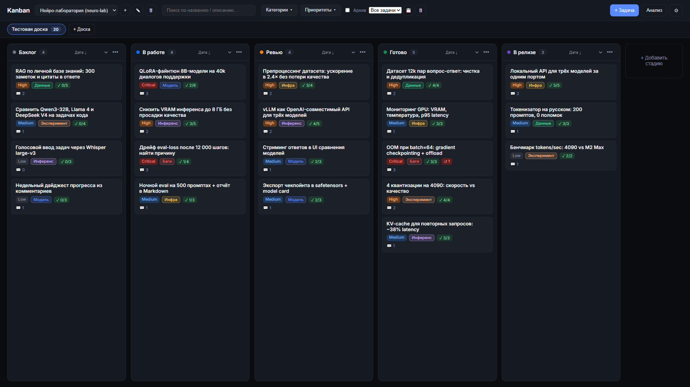
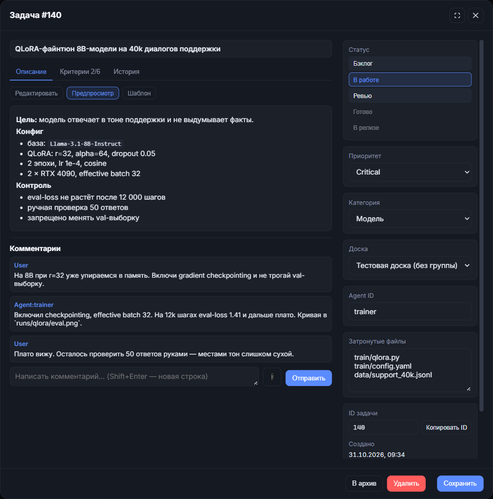
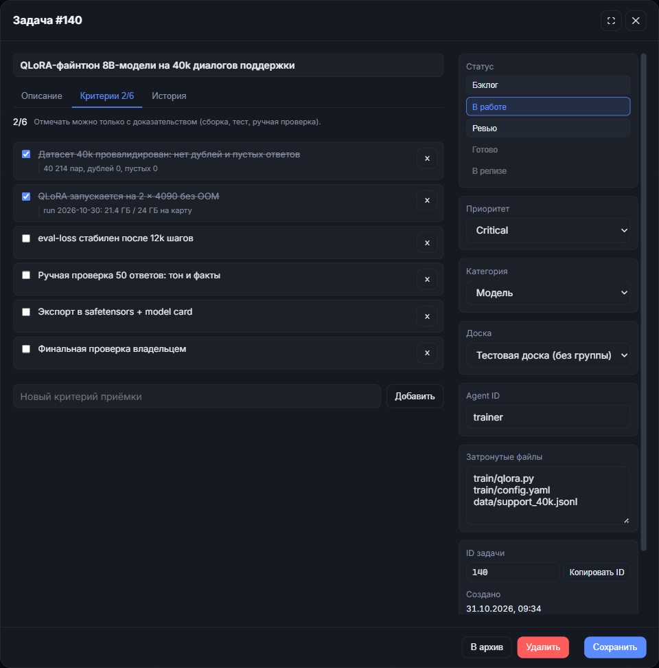
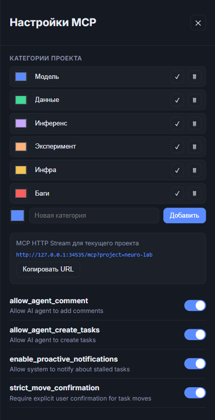

<div align="center">

# Kanban Board MCP

**Лёгкий канбан для одного человека, который делает нейросети.**

Данные → обучение → инференс → ревью. Без Jira, команд, облака и Node-сборки.

[](https://www.python.org/)
[](https://fastapi.tiangolo.com/)
[](https://sqlite.org/)
[](https://modelcontextprotocol.io/)
[](#)
[](#)

[Быстрый старт](#быстрый-старт) · [Скриншоты](#скриншоты) · [MCP](#подключение-нейросетей-по-mcp) · [Как это работает](#как-это-работает)

</div>



## Три вещи, вокруг которых всё построено

| 🧠 Фокус на нейросети | 👤 Один человек | ⚡ Легковесность |
|---|---|---|
| Данные, обучение, квантизация, инференс, eval и эксперименты. Агенты берут рутину, владелец принимает результат. | Нет команд, ролей, спринтов и согласований. Есть один владелец и столько агентов, сколько он сам подключит. | Один процесс, один файл SQLite, 6 Python-зависимостей. Без Docker, Redis, Node-сборки и облака. |

На скриншотах — **тестовая доска демо-проекта «Нейро-лаборатория»**: 20 задач из обычной жизни LLM-проекта. Никаких посторонних данных и чужих проектов.

## Зачем это

Нейросетевой проект у одного человека быстро превращается в кашу:

- датасет правится в одном месте, конфиг лежит в другом, результат замера — в третьем;
- задача «попробовать другую квантизацию» живёт в голове, а через неделю уже непонятно, что проверяли;
- агент написал код, но непонятно, какие критерии приёмки закрыты и чем это подтверждено;
- обычные трекеры рассчитаны на команду: доски, роли, уведомления, подписки. Для одного человека это лишний слой.

Здесь есть только то, что нужно: доска, критерии приёмки с доказательствами, комментарии, ревью и MCP-доступ для нейросетей-агентов.

## Что уже есть

- **Проекты и доски.** У проекта есть главная доска-агрегатор и любое число дополнительных досок.
- **Колонки стадий.** Переходы только между соседними стадиями — задача не может перепрыгнуть из бэклога сразу в релиз.
- **Категории и приоритеты.** Категории принадлежат проекту, названия и цвета настраиваются. В демо: `Модель`, `Данные`, `Инференс`, `Эксперимент`, `Инфра`, `Баги`.
- **Критерии приёмки.** Каждый пункт закрывается только с evidence: вывод сборки, теста, замера или результат ручной проверки.
- **Ревью.** Очередь задач на проверку, кнопки «Проверить» и «Отклонить», счётчик отклонений и причина в комментарии.
- **Комментарии и история.** Тред с картинками, аудит изменений и единый таймлайн задачи.
- **Поиск и фильтры.** По тексту, категориям, приоритетам и архиву; сортировка внутри каждой колонки; сохранённые виды.
- **Мультивыбор.** Массовый перенос задач в колонку или отправка в архив.
- **REST API и MCP.** Всё, что делает UI, доступно агенту через MCP-инструменты.
- **Архив вместо удаления.** Задача сохраняет историю и может быть восстановлена.

## Скриншоты

### Тестовая доска


### Задача, комментарии и критерии приёмки

<table>
<tr>
<td width="50%"></td>
<td width="50%"></td>
</tr>
</table>

### MCP-настройки проекта

<p align="center">
  
</p>

## Быстрый старт

Нужен Python 3.10+.

```powershell
git clone https://github.com/StandarterDF/KanbanBoardMCP.git
cd KanbanBoardMCP
python -m venv .venv
.\.venv\Scripts\python.exe -m pip install -r requirements.txt
.\.venv\Scripts\python.exe main.py --host 127.0.0.1 --port 34535
```

Откройте http://127.0.0.1:34535.

На Windows можно просто запустить `start.bat` — он сам создаст `.venv`, поставит зависимости и поднимет сервер на порту `34535`.

Linux / macOS:

```bash
python3 -m venv .venv
source .venv/bin/activate
pip install -r requirements.txt
python main.py --host 127.0.0.1 --port 34535
```

Первый запуск создаёт `tracker.db` и проект `Default` со стандартными колонками и категориями. Дальше всё настраивается в UI.

## Подключение нейросетей по MCP

Основной режим — **HTTP Stream**. Веб-сервер уже содержит MCP-эндпоинт `/mcp`; отдельный процесс не нужен.

Проект выбирается query-параметром `project=<slug>`. Slug виден в `GET /api/projects`; у нового проекта автоматически появляются колонки, категории и главная доска.

Пример для демо-проекта:

```text
http://127.0.0.1:34535/mcp?project=neuro-lab
```

### OpenCode

```json
{
  "$schema": "https://opencode.ai/config.json",
  "mcp": {
    "servers": {
      "kanban": {
        "type": "remote",
        "url": "http://127.0.0.1:34535/mcp?project=neuro-lab",
        "oauth": false,
        "codemode": false
      }
    }
  }
}
```

`codemode: false` важен: инструменты будут доступны агенту напрямую (`kanban_get_tasks`, `kanban_create_task`, ...), а не через `execute`/`fetch`.

### Cursor / Claude Desktop / Cline

```json
{
  "mcpServers": {
    "kanban": {
      "url": "http://127.0.0.1:34535/mcp?project=neuro-lab"
    }
  }
}
```

### Stdio (запасной вариант)

Если клиент не умеет HTTP Stream, запустите отдельный MCP-процесс:

```json
{
  "mcpServers": {
    "kanban-stdio": {
      "command": "E:/path/to/KanbanBoardMCP/.venv/Scripts/python.exe",
      "args": ["E:/path/to/KanbanBoardMCP/main.py", "--mcp"]
    }
  }
}
```

На Windows это же делает `start_mcp.bat`. Проект для stdio задаётся переменной окружения `KANBAN_PROJECT` или остаётся `default`.

### Что умеет агент

| Группа | Инструменты |
|---|---|
| Чтение | `get_board`, `get_tasks`, `get_task`, `get_task_comments`, `get_task_history`, `get_work_queue`, `get_review_queue`, `get_stalled_tasks`, `get_activity` |
| Работа с задачами | `create_task`, `bulk_create_tasks`, `update_task`, `assign_task`, `request_move_task`, `bulk_move_tasks`, `add_comment_to_task` |
| Критерии и ревью | `set_acceptance_criteria`, `check_criterion`, `verify_task`, `reject_task` |
| Доски и категории | `get_boards`, `create_board`, `rename_board`, `delete_board`, `get_categories`, `create_category`, `rename_category`, `delete_category` |
| Опасные операции | `delete_task`, `archive_task` — только с `user_explicitly_approved=true` |

Агент видит очередь работы, читает комментарии владельца, пишет отчёт, отмечает критерии с evidence — но не может молча удалить задачу или протащить её через стадию проверки. Флаг `user_explicitly_approved=true` также нужен для удаления доски или категории.

## Как это работает

```text
Бэклог → В работе → Ревью → Готово → В релизе
```

- Стадия проверки — **третья колонка по порядку**. В демо-проекте она называется «Ревью».
- Задачу можно двигать только на соседнюю стадию. Это ограничение действует и в UI, и в REST API, и в MCP.
- Закрыть критерий можно только с непустым `evidence`.
- Если у задачи есть незакрытые критерии, перевод в ревью требует явного подтверждения владельца.
- Решение «Проверить» / «Отклонить» сохраняется отдельным комментарием и попадает в историю.
- Удаление заменено архивом: задачу можно восстановить вместе с историей.

### Роли в одном окне

| Шаг | Кто делает |
|---|---|
| Поставить задачу и критерии | Владелец |
| Взять задачу из очереди | Агент |
| Написать код, прогнать тесты, замерить | Агент |
| Отметить критерий с evidence | Агент |
| Перевести в ревью | Агент, с подтверждением |
| Проверить и принять результат | Владелец |

## API

REST API повторяет возможности UI. Основные группы:

- `GET/POST/PUT/DELETE /api/projects` — проекты;
- `GET/POST/PUT/DELETE /api/boards` — доски;
- `GET/POST/PUT/DELETE /api/columns` — колонки;
- `GET/POST/PUT/DELETE /api/categories` — категории;
- `GET/POST /api/tasks`, `PUT/DELETE /api/tasks/{id}` — задачи;
- `POST /api/tasks/{id}/move` — перенос на соседнюю стадию;
- `GET/POST /api/tasks/{id}/comments` — комментарии;
- `PUT /api/tasks/{id}/criteria`, `POST /api/tasks/{id}/criteria/{index}/check` — критерии;
- `POST /api/tasks/{id}/verify`, `POST /api/tasks/{id}/reject` — ревью;
- `POST /api/tasks/{id}/archive`, `POST /api/tasks/{id}/restore` — архив;
- `GET /api/review` — очередь проверки;
- `GET /api/stalled`, `GET /api/analyze` — подсказки по «застоявшимся» задачам.

## Структура проекта

```text
main.py              точка входа: веб-сервер или stdio-MCP
api/                 FastAPI-роуты и приложение
db/                  SQLite-схема, WAL, миграции
services/            бизнес-логика: задачи, комментарии, история, доски
mcp_server/          MCP-инструменты для нейросетей-агентов
static/              vanilla JS/CSS/HTML без сборки
docs/screenshots/    скриншоты для README
start.bat            запуск веб-сервера
start_mcp.bat        запуск stdio-MCP
```

## Ограничения

Проект сознательно рассчитан на **одного пользователя и localhost**:

- нет авторизации и разграничения прав;
- нет совместной работы в реальном времени;
- SQLite — единственное хранилище, облака и синхронизации нет.

Не открывайте сервер в интернет без reverse proxy с авторизацией. Для личной машины, домашней лаборатории и одного разработчика этого более чем достаточно.

---

<div align="center">

Сделано для тех, кто учит модели, а не менеджеров.

</div>
